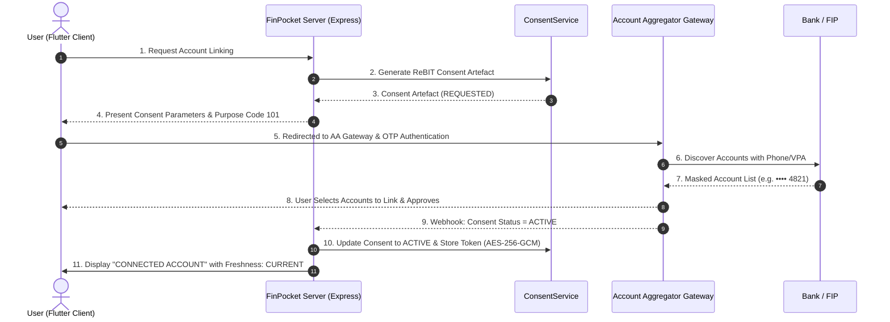

# Account Aggregator (AA) Integration Architecture & Ecosystem Specifications

## 1. Executive Summary & Regulatory Context

> [!IMPORTANT]
> FinPocket is engineered in **technical alignment** with the **Reserve Bank of India (RBI) Non-Banking Financial Company - Account Aggregator (NBFC-AA) Master Directions** and technical specifications governed by **ReBIT (Reserve Bank Information Technology)** and **Sahamati**.
> This constitutes architectural and technical readiness. Full regulatory compliance and production data access require independent legal registration, CERT-In VAPT audit, and licensed AA provider onboarding.

| Source | Reference Document / Version | Requirement Summary | FinPocket Architectural Impact |
| :--- | :--- | :--- | :--- |
| **RBI** | Master Direction DNBR.PD.009/03.10.119/2016-17 | Consent-based financial data sharing; no financial assets handling | FinPocket operates as a pure data consumer (FIU); zero money-movement over AA |
| **ReBIT** | Technical Framework for AA Ecosystem v1.1.2 | Standardized JSON schemas for Consent Artefact, Discovery, Data Flow | Standardized entity normalization & ReBIT consent lifecycle |
| **Sahamati** | Interoperability Guidelines & Flow Spec 2023 | Encrypted end-to-end data delivery (ECDH); strict purpose coding | AES-256-GCM token storage; read-only Safe-to-Spend calculations |

---

## 2. Implementation & Integration Status Breakdown

### 2.1 [IMPLEMENTED] (In Codebase & Automated Test Suite)
- **FinancialDataProvider Abstraction**: Boundary separating business calculations from data sources.
- **AccountAggregatorProvider**: Full ReBIT sandbox HTTP client with retry, exponential backoff, circuit breaker, and token encryption.
- **MockFinancialDataProvider**: Deterministic demo provider for offline/local execution.
- **FakeAccountAggregatorProvider**: Automated testing adapter simulating timeouts, 502 malformed responses, 503 outages, duplicate batches, and expired consents.
- **ReBIT Consent Lifecycle Engine (`ConsentService`)**: Creation, server-side validation, expiry calculation, and immediate revocation.
- **Cryptographic Webhook Verification (`AACallbackService`)**: HMAC-SHA256 signature verification, replay protection (nonce cache), timestamp drift window (5 min), and session correlation.
- **Data Normalization Engine (`DataNormalizationService`)**: Standardizes account types, directions, ISO timestamps, and financial categories.
- **Authoritative Balance & Transaction Reconciliation (`TransactionReconciliationService`)**: Duplicate prevention via `(account_id, provider_transaction_id)` composite key; external balance is authoritative source-of-truth.
- **Data Freshness Tracker**: Explicit tagging of datasets with `CURRENT`, `STALE`, `SYNCING`, `FAILED`, `NEVER_SYNCED`.
- **At-Rest Token Encryption (`ProviderSecurityService`)**: AES-256-GCM encryption with RFC 5869 HKDF key derivation and domain separation.
- **Fail-Closed Production Config**: Strict fail-closed startup abort if AA provider is enabled in PRODUCTION without production endpoints/credentials.
- **Audit Logging**: Structured security events emitted for all consent and sync actions.
- **Flutter UI Integration**: Visual status indicators for `DEMO ACCOUNT`, `CONNECTED ACCOUNT`, `CURRENT`, `STALE`, `SYNCING`, `FAILED`, `NEVER SYNCED`.

### 2.2 [DESIGNED] (Architecture & Protocols Prepared)
- **ECDH / Ephemeral Key Exchange**: Diffie-Hellman cryptographic negotiation for direct FIP-to-FIU data tunnel decryption.
- **PostgreSQL Connection Pool**: Production configuration mapped for high-concurrency cloud environments.

### 2.3 [REQUIRES PROVIDER ONBOARDING] (Production Prerequisites)
- **FIU Entity Registration**: Formal application and approval as a regulated Financial Information User (FIU) under RBI regulations.
- **Sahamati Central Registry Onboarding**: Obtaining production FIU credentials, client certificates, and participation keys.
- **Contractual SLA with Licensed AA**: Direct agreements with licensed Account Aggregators (e.g., Setu, OneMoney, Finvu, Anumati).
- **Security Audit & VAPT Certification**: Mandatory third-party CERT-In empanelled cybersecurity compliance audit.

### 2.4 [NOT IMPLEMENTED] (Strict Safety Guardrails)
- **Screen Scraping**: Strictly prohibited.
- **Banking Password / UPI PIN Collection**: Strictly prohibited.
- **Direct Money Transfer / Payment Execution via AA**: AA ecosystem is strictly read-only data infrastructure; no funds movement is allowed or implemented.

---

## 3. Account Discovery & Consent Data Flow

---

## 4. Unlinking & Revocation Flow
When a user requests to unlink a bank account or revoke consent:
1. `ConsentService.revokeConsent()` marks the internal consent record as `REVOKED` and records `revoked_at`.
2. Downstream calls to the AA gateway inform the broker to invalidate tokens.
3. The account connection status is updated to `REVOKED`.
4. Subsequent fetch attempts are blocked server-side by `validateConsentForFetch()`.
5. Historical transaction records remain queryable for tax/planning purposes but are marked as unlinked.
6. A tamper-evident `ACCOUNT_UNLINKED` and `CONSENT_REVOKED` audit log is permanently persisted.
