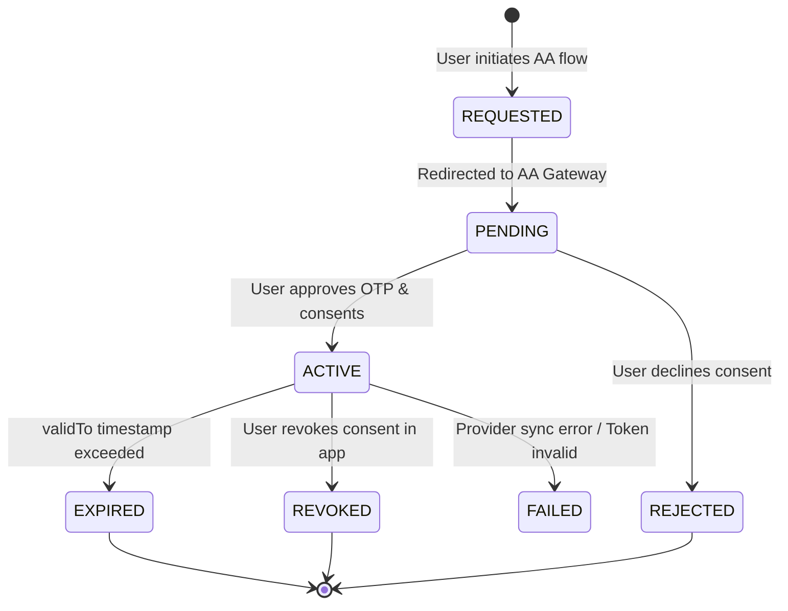

# FinPocket Financial Data Layer & Integration Architecture

## 1. Architectural Overview & Boundary Principles

FinPocket employs a strict, provider-neutral architecture to ingest, normalize, reconcile, and persist financial records without allowing external provider schemas or direct client network calls to penetrate business intelligence services.

```
┌─────────────────────────────────────────────────────────────┐
│                 Flutter Client Application                  │
│   (Never receives provider secrets or talks directly to AA) │
└──────────────────────────────┬──────────────────────────────┘
                               │ JSON over HTTPS (JWT Authenticated)
                               ▼
┌─────────────────────────────────────────────────────────────┐
│                   Express API Routing Layer                 │
│      (authMiddleware, rateLimiter, requestId, validate)     │
└──────────────────────────────┬──────────────────────────────┘
                               │
                               ▼
┌─────────────────────────────────────────────────────────────┐
│             FinancialDataProvider (Boundary)                │
│    ├── MockFinancialDataProvider (Demo / Local Testing)     │
│    ├── FakeAccountAggregatorProvider (Automated Test Suite) │
│    └── AccountAggregatorProvider (Production ReBIT Gateway) │
└──────────────────────────────┬──────────────────────────────┘
                               │
                               ▼
┌─────────────────────────────────────────────────────────────┐
│                 Data Normalization Layer                    │
│   (Standardizes Account Types, Transaction Categories, ISO) │
└──────────────────────────────┬──────────────────────────────┘
                               │
                               ▼
┌─────────────────────────────────────────────────────────────┐
│              Transaction Reconciliation Engine              │
│    (Deterministic deduplication, NEW/UPDATED/UNCHANGED)     │
└──────────────────────────────┬──────────────────────────────┘
                               │
                               ▼
┌─────────────────────────────────────────────────────────────┐
│             Database Abstraction Repositories               │
│    ├── SQLite Repositories (DEMO / TEST / LOCAL DEV)        │
│    └── PostgreSQL Repositories (STAGING / PROD with RLS)    │
└─────────────────────────────────────────────────────────────┘
```

---

## 2. Technical Alignment with ReBIT Account Aggregator (AA) Guidelines

> [!NOTE]
> FinPocket's architecture is engineered in technical alignment with the Reserve Bank of India (RBI) NBFC-Account Aggregator Master Directions and ReBIT Technical Frameworks. Formal regulatory compliance requires independent institutional certification, regulated FIU licensing, and contractual provider onboarding.

### 2.1 Ecosystem Roles & Technical Model
- **Financial Information User (FIU) Model**: FinPocket's backend is structured to consume read-only account data solely for personal budgeting and cashflow calculations.
- **Account Aggregator (AA) Gateway**: Interfaces with licensed NBFC-AAs (e.g., Setu, OneMoney, Finvu) via standardized consent lifecycles.
- **Financial Information Provider (FIP)**: Source institutions holding user banking data.

### 2.2 ReBIT Technical Specifications Alignment
| Requirement | Specification | FinPocket Technical Implementation |
| :--- | :--- | :--- |
| **Purpose Limitation** | RBI Code `101` (Personal Finance Management) | Scoped purpose binding in consent artifact (`ConsentService`) |
| **Data Categories** | `TRANSACTIONS`, `BALANCES`, `PROFILE` | Explicit data category scopes requested at consent creation |
| **Consent Duration** | Explicit `validFrom` and `validTo` | ReBIT ISO-8601 validity window (default: 365 days) |
| **Fetch Cadence** | `PERIODIC` or `ONE_TIME` | Configurable fetch frequency tracked in `AccountConsentEntity` |
| **Revocation** | Immediate downstream cancellation | Immediate server-side status update to `REVOKED` halting all fetches |
| **Token Encryption** | AES-256-GCM / HKDF Key Derivation | Provider tokens encrypted at rest via `ProviderSecurityService` (RFC 5869 HKDF) |

---

## 3. Consent Lifecycle & Authoritative Validation

Financial data is **NEVER** fetched merely because an account record exists. Server-side validation strictly enforces:

$$\text{Valid Fetch} = \text{Authenticated User} \land \text{Active Consent} \land \text{Unexpired Validity Window} \land \text{Valid Provider Connection}$$



---

## 4. Normalization & Transaction Reconciliation

### 4.1 Data Normalization
Raw provider JSON structures are transformed into `FinancialAccountEntity` and `FinancialTransactionEntity` objects:
- **Account Types**: Normalized to `SAVINGS`, `CURRENT`, `CREDIT_CARD`, `LOAN`.
- **Direction**: Computed to `INCOME` (credit) or `EXPENSE` (debit).
- **Categories**: Mapped to standard system categories (`Food`, `Shopping`, `Travel`, `Bills`, `Rent`, `Salary`, `EMI`, `Health`, `Other`).
- **Timestamps**: Normalized to UTC ISO-8601.

### 4.2 Deterministic Reconciliation Matrix
When a sync batch is ingested, each transaction is evaluated against existing records:

| Provider Reference Match | Amount & Timestamp Match | Resulting Status | Action |
| :--- | :--- | :--- | :--- |
| **Found** | Identical | `UNCHANGED` | Skipped |
| **Found** | Value/Category Modified | `UPDATED` | Existing row updated in place |
| **Not Found** | Not Found | `NEW` | Inserted as new transaction row |
| **Duplicate in Batch** | Duplicate `providerTransactionId` | `DUPLICATE` | Deduplicated in-memory |

*Repeated sync of the same dataset produces $0$ new duplicate rows (100% idempotent).*

---

## 5. Data Freshness Model

Every financial account and transaction query surfaces explicit data freshness:
- **`CURRENT`**: Synchronized successfully within the last 24 hours.
- **`STALE`**: Last successful synchronization occurred $>24$ hours ago.
- **`SYNCING`**: Active background synchronization in progress.
- **`FAILED`**: Most recent synchronization attempt failed; previous valid balance retained.
- **`NEVER_SYNCED`**: Account newly linked; initial synchronization pending.

---

## 6. PostgreSQL Target Layer & Row-Level Security (RLS)
*Status: Statically Validated & Schema-Ready (Cloud Integration Testing Pending Dedicated Environment Provisioning)*

### 6.1 Database Isolation & Strategy
- **DEMO / TEST**: SQLite 3 with WAL mode, foreign key enforcement, and parameterized queries (Fully automated test verified).
- **PRODUCTION TARGET**: PostgreSQL 15+ with connection pooling (`pg.Pool`), TLS encryption, and Row-Level Security (RLS). Schema statically validated in [`postgres_schema.sql`](file:///d:/Finpocket%20Final%20Mobile/finpocket_server/src/config/postgres_schema.sql).

### 6.2 PostgreSQL RLS Policies
```sql
-- Enforce RLS on user-owned tables
ALTER TABLE bank_accounts ENABLE ROW LEVEL SECURITY;
ALTER TABLE transactions ENABLE ROW LEVEL SECURITY;
ALTER TABLE account_consents ENABLE ROW LEVEL SECURITY;
ALTER TABLE provider_connections ENABLE ROW LEVEL SECURITY;

-- Context set securely per authenticated request:
-- SET LOCAL app.current_user_id = 'usr_123';
CREATE POLICY user_isolation_bank_accounts ON bank_accounts
    FOR ALL
    USING (user_id = current_setting('app.current_user_id', true))
    WITH CHECK (user_id = current_setting('app.current_user_id', true));
```

---

## 7. Security Boundary & Token Encryption

1. **Client Isolation**: The Flutter application NEVER receives database credentials, provider API keys, or raw provider access tokens.
2. **At-Rest Token Encryption**: All provider refresh/access tokens are encrypted using `AES-256-GCM` with a 12-byte IV and 16-byte authentication tag before insertion into `provider_connections`.
3. **AI Assistant Guardrails**:
   - AI assistant tools are strictly read-only allowlisted.
   - AI cannot view provider secrets or credentials.
   - AI cannot trigger background synchronization.
4. **Audit Trail**: All lifecycle events (`ACCOUNT_LINK_STARTED`, `CONSENT_REQUESTED`, `CONSENT_APPROVED`, `CONSENT_REVOKED`, `ACCOUNT_DISCOVERED`, `ACCOUNT_LINKED`, `SYNC_STARTED`, `SYNC_SUCCESS`, `SYNC_FAILED`, `ACCOUNT_UNLINKED`) are written to `audit_logs` with correlation IDs.
